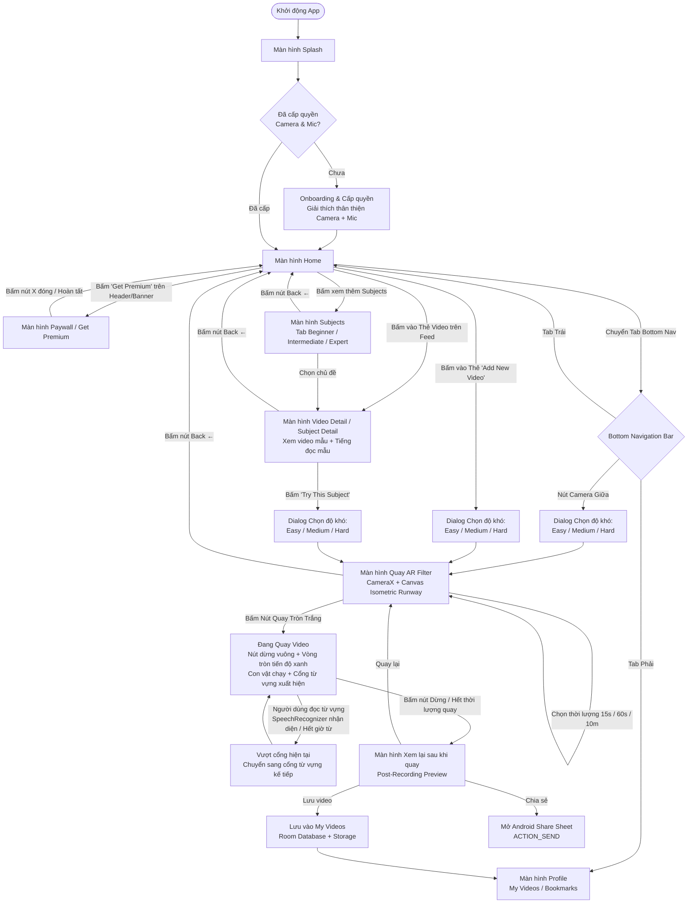

# TÀI LIỆU ĐẶC TẢ TRẢI NGHIỆM NGƯỜI DÙNG (UX SPECIFICATION)
## DỰ ÁN: VoiceFilter speak_challenge (Nói Chuẩn: Thử Thách Phát Âm)
**Phiên bản:** 1.0.0  
**Tác giả:** Senior Android Engineer & UX Analyst  
**Căn cứ tư liệu:** Tư liệu thực tế trong thư mục `reference/` (2 video quay thực tế + 6 ảnh chụp màn hình từ app gốc iOS "Voice Filter: Speak Challenge").

---

## 1. SƠ ĐỒ LUỒNG ỨNG DỤNG (USER FLOW - MERMAID)

---

## 2. BẢN CHẤT ỨNG DỤNG & NGUYÊN TẮC THIẾT KẾ

### 2.1 Bản chất ứng dụng (Xác nhận từ tư liệu thực tế)
- **Đây là một ứng dụng QUAY VIDEO CÓ FILTER AR ISOMETRIC 3D** để người dùng thử thách phát âm từ vựng tiếng Anh theo từng chủ đề.
- **KHÔNG PHẢI LÀ GAME CHẤM ĐIỂM:** Ứng dụng **không có** điểm số (score), số sao (stars), chuỗi ngày (streak), thanh máu hay bảng xếp hạng. Người dùng quay video khuôn mặt của chính họ trong khi con thú hoạt hình chạy vượt qua các cổng từ vựng, tạo thành một video ngắn vui nhộn để lưu lại hoặc chia sẻ lên mạng xã hội (TikTok, Shorts, Reels).
- **Môi trường hoạt động:** Video quay camera trước toàn màn hình làm nền, lớp đồ họa 3D Isometric được vẽ đè lên trên (AR Overlay) nghiêng từ góc dưới bên trái lên góc trên bên phải.

### 2.2 Quy tắc bản quyền
- **Tên ứng dụng:** "VoiceFilter speak_challenge" (Hiển thị tiếng Việt: "Nói Chuẩn: Thử Thách Phát Âm").
- **Tài sản tự tạo 100%:** Tuyệt đối không sao chép hình ảnh khuôn mặt người thật, linh vật con cáo của app iOS, logo các hãng xe có bản quyền (Ford, Nissan, BMW, Honda...), âm thanh của người dùng khác, hay tài liệu marketing.
- Toàn bộ đường chạy, linh vật chạy, cổng gỗ, icon và card chủ đề đều được tự tạo bằng **Jetpack Compose Canvas** và các vector đồ họa độc quyền.

---

## 3. ĐẶC TẢ CHI TIẾT TỪNG MÀN HÌNH

### 3.1 Màn hình Splash & Onboarding cấp quyền
- **Mục đích:** Giới thiệu ngắn gọn tinh thần ứng dụng và xin 2 quyền bắt buộc: `CAMERA` và `RECORD_AUDIO`.
- **Giao diện:**
  - Nền gần trắng (`#F8F9FD`), tiêu đề xanh `#2F80ED` phong cách thân thiện.
  - Hình minh họa trực quan về trải nghiệm: Mặt người dùng + đường chạy từ vựng + hiệu ứng AR.
  - Thẻ giải thích lý do rõ ràng:
    - *Camera:* "Để hiển thị khuôn mặt bạn cùng hiệu ứng đường chạy từ vựng độc đáo."
    - *Microphone:* "Để nhận diện giọng nói khi bạn đọc từ vựng và ghi âm cho video của bạn."
  - Nút bấm chính: Nút Pill bo tròn màu xanh `#2F80ED` "Bắt đầu ngay" / "Cấp quyền & Tiếp tục".

---

### 3.2 Màn hình Home (Màn hình chính)
*Căn cứ: Ảnh `reference/1790562582139...jpg`, `...2230...jpg`, frame 15 - 55 của Video 1.*

- **Thanh tiêu đề (Top Bar):**
  - Góc trái: Chữ **"Voice Filter"** (Typography Sans-serif hình học, font-weight Bold/SemiBold, cỡ chữ 24sp, màu xanh thương hiệu `#2F80ED`).
  - Góc phải: Nút Pill **"Get Premium"** (nền xanh `#2F80ED`, chữ trắng, bo tròn 999dp, padding ngang 16dp, dọc 8dp).
- **Banner quảng cáo Premium (Hero Card):**
  - Kích thước: Chiều ngang khớp lề màn hình (margin ngang 16dp), chiều cao ~140dp, bo góc ~20dp.
  - Nền: Gradient xanh dương chuyển sắc nhẹ (`#2F80ED` đến `#4FC3F7`).
  - Cột trái:
    - Tiêu đề: **"Unlock all features"** (chữ trắng, 2 dòng, font Bold 20sp).
    - Nút phụ: **"Get Premium"** dạng Pill nhỏ (nền trắng `#FFFFFF`, chữ xanh `#2F80ED`, font SemiBold 13sp).
  - Cột phải: Hình vẽ minh họa nhân vật đang hào hứng cầm điện thoại, kèm 2 bong bóng thoại ví dụ từ phát âm khó ("WORCESTERSHIRE", "ONOMATOPOEIA").
- **Hàng Chip chủ đề cuộn ngang (Horizontal Category Chips):**
  - Nằm ngay dưới banner, vuốt mượt mà từ trái qua phải.
  - Mỗi Chip là hình viên thuốc bo góc tròn hoàn toàn (corner radius 50% / 999dp).
  - **Trạng thái Active (đang chọn):** Nền xanh dương `#2F80ED`, chữ màu trắng `#FFFFFF`, font-weight SemiBold.
  - **Trạng thái Inactive (chưa chọn):** Nền xanh nhạt dịu mát `#EBF3FE`, chữ màu xanh xám `#829AC4`, font-weight Medium.
  - Danh sách chủ đề thấy được trong video/ảnh:
    1. *Colors* (Màu sắc)
    2. *Car Brands* (Hãng xe)
    3. *Weekdays* (Ngày trong tuần)
    4. *Countries* (Quốc gia)
    5. *Alphabet* (Bảng chữ cái)
    6. *Months* (Tháng trong năm)
    7. *Vehicles* (Phương tiện giao thông)
    8. *Kitchen Utensils* (Dụng cụ nhà bếp)
    9. *Animals* (Động vật)
    10. *Emotions* (Cảm xúc)
    11. *Vegetables* (Rau củ)
    12. *Activities* (Hoạt động)
    13. *School* (Trường học)
    14. *Weather* (Thời tiết)
    15. *Movie Genres* (Thể loại phim)
    16. *Music Genres* (Thể loại âm nhạc)
- **Lưới Video Feed 2 cột (Vertical 2-Column Grid):**
  - Tỉ lệ thẻ video: 3:4 hoặc 9:16 dọc, bo góc tròn 16dp.
  - Khoảng cách giữa các thẻ: 12dp.
  - Nội dung mỗi thẻ video mẫu:
    - **Ảnh preview video:** Gồm mặt người dùng đang quay + lớp filter AR đường chạy và cổng gỗ.
    - **Huy hiệu cấp độ (Level Badge) góc trên bên trái:**
      - "Beginner": Pill màu xanh dương sáng `#29B6F6` (hoặc `#2F80ED`), chữ trắng.
      - "Intermediate": Pill màu vàng cam ấm `#FFA726`, chữ trắng.
      - "Expert": Pill màu đỏ san hô `#EF5350`, chữ trắng.
    - **Thời lượng:** Icon micro màu trắng + đồng hồ đếm (ví dụ `00:01`, `00:02`).
    - **Phần chân thẻ (Footer):**
      - Dòng 1: Tên chủ đề màu xanh `#2F80ED` (ví dụ "Colors", "Car Brands"). Bên phải là icon Bookmark hình dải ruy băng viền xanh `#2F80ED`.
      - Dòng 2: Số người học (ví dụ "19740 Learners", "33224 Learners", "15516 Learners", "8023 Learners") màu xám đen `#49454F`.
  - **Thẻ "Add New Video" (Khi chủ đề chưa có video hoặc người dùng muốn quay mới):**
    - Chiếm 1 ô trong lưới 2 cột.
    - Nền hình minh họa vector theo chủ đề (ví dụ quả địa cầu cho Countries, tờ lịch cho Months, chú gấu trúc cho Animals...).
    - Ở giữa là **Dấu cộng màu trắng lớn `+`**.
    - Phía trên có badge độ khó (Beginner / Intermediate / Expert).
    - Phía dưới ghi chữ "Add New Video" màu xanh `#2F80ED`.
- **Thanh Bottom Navigation Bar dạng Floating Capsule (Viên thuốc nổi):**
  - Đặt nổi lơ lửng cách đáy màn hình ~16dp, căn giữa.
  - Hình dạng: Capsule tròn hai đầu (Corner radius 36dp), màu nền trắng tinh khiết `#FFFFFF`, đổ bóng nhẹ sang trọng (`elevation` 8dp, shadow blur 16dp).
  - 3 nút chức năng:
    1. **Nút Home (trái):** Icon ngôi nhà nét thanh màu xanh `#2F80ED`.
    2. **Nút Camera (giữa):** Nút tròn đặc nổi bật màu xanh `#2F80ED` (kích thước ~52dp), bên trong là biểu tượng máy ảnh màu trắng `#FFFFFF`. Bấm vào sẽ mở thẳng Dialog chọn độ khó để quay ngay!
    3. **Nút Profile (phải):** Icon người dùng màu xanh `#2F80ED`.

---

### 3.3 Màn hình Subjects (Kho chủ đề tổng hợp)
*Căn cứ: Ảnh `reference/1790562582206...jpg`.*

- **Thanh Header:**
  - Nút back (`←`) màu đen đậm bên trái.
  - Tiêu đề ở giữa: **"Subjects"** (chữ to, màu xanh `#2F80ED`).
- **3 Tab phân loại cấp độ (Difficulty Tabs):**
  - Bố trí ngang dạng chip/tab bo góc tròn hoàn toàn:
    1. **Beginner:** Khi active có nền xanh dương `#2F80ED`, chữ trắng `#FFFFFF`.
    2. **Intermediate:** Nền màu vàng cam pastel nhẹ (`#FFF3E0`), chữ màu cam đất đậm (`#E65100`).
    3. **Expert:** Nền màu hồng đỏ pastel nhẹ (`#FFEBEE`), chữ màu đỏ đậm (`#D32F2F`).
- **Lưới danh mục 2 cột (2-Column Grid):**
  - Các card hình vuông bo góc tròn lớn ~24dp.
  - Nền card: Màu pastel rất nhẹ dịu mắt (xanh da trời nhạt `#E1F5FE`, be nhạt `#FFF8E1`, xanh ngọc nhạt `#E0F2F1`).
  - Hình minh họa đồ họa vector đặc trưng:
    - *Alphabet:* Bộ 3 chữ cái bóng 3D A-B-C đầy màu sắc.
    - *Weekdays:* Tờ lịch lò xo lật sang thứ Năm ("THU").
    - *Months:* Tờ lịch treo tường tháng 10 ("OCTOBER").
    - *Vehicles:* Xe SUV địa hình và xe máy tay ga góc nhìn isometric.
    - *Kitchen Utensils:* Bộ đồ làm bếp ấm đun, nồi áp suất, chảo chiên.
    - *Animals:* Chú gấu trúc chibi dễ thương trên thảm cỏ.
  - Tên chủ đề in đậm màu xanh `#2F80ED` nằm ngay bên dưới mỗi card.
  - Bấm vào một chủ đề sẽ dẫn tới màn hình Video Detail / Subject Detail.

---

### 3.4 Màn hình Video Detail / Subject Detail
*Căn cứ: Frame 60 - 65 của Video 1 và Frame 0 của Video 2.*

- **Thanh Top Bar:**
  - Nút back (`←`) bên trái.
  - Tiêu đề chủ đề ở giữa (ví dụ "Colors") màu xanh `#2F80ED`.
  - Phụ đề nhỏ: "19740 Learners".
  - Icon Bookmark ở góc phải (cho phép lưu chủ đề vào mục yêu thích).
- **Trình phát Video (Video Player):**
  - Chiếm khoảng 70% chiều cao màn hình, bo góc cong ~20dp.
  - Tự động phát video người dùng mẫu đọc từ vựng với đường chạy AR.
  - Hiển thị badge icon mic tròn màu xanh + hộp thời gian (ví dụ `00:02`, `00:12`).
  - Có âm thanh thật của người nói phát ra khi video chạy.
- **Nút hành động chính (Bottom CTA):**
  - Nút bấm dài bo tròn toàn phần (Pill shape) màu xanh `#2F80ED`, chữ in đậm màu trắng: **"Try This Subject"**.
  - Khi người dùng bấm nút này -> Mở Modal Dialog "Choose your difficulty mode".

---

### 3.5 Modal Dialog "Choose your difficulty mode" (Chọn độ khó)
*Căn cứ: Frame 0 của Video 2 và Frame 64 của Video 1.*

- **Hiển thị:** Popup nổi giữa màn hình trên nền tối mờ (dim backdrop `rgba(0, 0, 0, 0.5)`).
- **Khung chứa (Container):** Màu trắng tinh `#FFFFFF`, bo góc mềm mại ~24dp, padding 24dp.
- **Tiêu đề:** **"Choose your difficulty mode"** (Chữ đen đậm 18sp, căn giữa).
- **3 nút lựa chọn độ khó (Stack dọc, bo góc ~14dp, chiều cao 50dp):**
  1. **Nút "Easy":** Nền màu xanh dương đậm `#2F80ED`, chữ trắng in đậm.
  2. **Nút "Medium":** Nền màu vàng cam rực rỡ `#FFA726` (hoặc `#FF9800`), chữ trắng in đậm.
  3. **Nút "Hard":** Nền màu đỏ san hô `#EF5350`, chữ trắng in đậm.
- Khi người dùng bấm chọn 1 trong 3 mức độ, popup đóng lại và chuyển ngay vào màn hình **Recording (Quay video AR)** với bộ từ vựng tương ứng cấp độ đã chọn.

---

### 3.6 Màn hình Quay AR Filter (Recording Screen)
*Căn cứ: Ảnh `reference/1790562582253...jpg`, Frame 70 Video 1, Frame 3-14 Video 2.*

- **Lớp nền Camera (Background):**
  - Toàn màn hình bằng CameraX (mặc định Camera trước - Selfie preview).
  - Tỉ lệ khung hình toàn màn hình điện thoại (Full screen 16:9 / 20:9).
- **Nút Back góc trên bên trái:**
  - Mũi tên trắng (`←`) có shadow mờ nhẹ để luôn nhìn thấy rõ trên mọi phông nền camera.
- **Cột công cụ dọc bên phải (Vertical Tool Column):**
  - Gồm 4 nút xếp dọc, mỗi nút có icon màu trắng + nhãn text tiếng Anh bên dưới:
    1. **Flip:** Biểu tượng 2 mũi tên xoay tròn (đổi giữa camera trước và camera sau).
    2. **Flash:** Biểu tượng tia sét có gạch chéo (bật/tắt đèn flash, chỉ khả dụng với camera sau).
    3. **Skin:** Biểu tượng khuôn mặt lấp lánh (stub làm đẹp da / mịn da).
    4. **Lips:** Biểu tượng đôi môi (stub son môi).
- **Lớp AR Isometric 3D Canvas (Overlay Runway):**
  - **Đường chạy (Runway):**
    - Nghiêng góc chéo ~35-45 độ từ góc dưới bên trái màn hình kéo dài chéo lên góc trên bên phải.
    - Bề mặt đường: Màu xanh chanh neon rực rỡ (`#AEEA00` / `#9CCC65`), có các ô vuông điểm xuyết màu xanh sáng (`#C6FF00`) di chuyển liên tục tạo hiệu ứng đường băng đang chuyển động cuộn về phía trước.
    - Cạnh bên đường chạy: Có độ dày 3D đa tầng (tầng trên màu xanh xám rêu `#557A60`, tầng dưới màu xanh rêu đậm `#37474F`).
    - Viền đường chạy: Có dải sọc chéo đỏ - trắng trang trí kiểu đường đua.
  - **Linh vật chạy (Runner Character):**
    - Chú linh vật hoạt hình hình hộp lập phương 3D màu cam ấm (`#FF6D00`), tai nhọn, mõm trắng nhỏ, mắt đen to tròn, 4 chân ngắn chuyển động nhịp nhàng chạy lon ton trên đường băng.
    - Linh vật chạy cố định ở 1/3 góc dưới bên trái của đường băng.
  - **Cổng chướng ngại vật từ vựng (Word Gates):**
    - Hình dạng cổng chữ nhật 3D đứng, vân gỗ sồi (`#C49A6C`), ở chân khoét vòm cửa hình chữ nhật màu nâu để linh vật chạy xuyên qua.
    - Phía trên vòm cổng in chữ từ vựng tiếng Anh to, rõ nét, font đậm (màu trắng `#FFFFFF` hoặc màu đỏ `#D32F2F` tùy chủ đề).
    - Cổng di chuyển từ góc trên bên phải lướt xuống góc dưới bên trái theo trục đường băng.
    - Các vật thể trang trí bổ sung: Vòng tròn Torus màu tím/hồng bay lơ lửng dọc đường chạy.
- **Bộ chọn thời lượng (Duration Selector):**
  - Đặt nằm ngay phía trên nút quay: Dãy chữ **`15s`   `60s`   `10m`**.
  - Font chữ màu trắng, có đổ bóng nhẹ.
  - Có một **chấm tròn màu trắng nhỏ (dot indicator)** nằm ngay trên mốc đang chọn (mặc định là `15s`).
- **Nút Quay (Record Button):**
  - Vị trí: Đặt chính giữa phía dưới màn hình.
  - **Khi chưa quay (Idle state):**
    - Là một hình tròn màu trắng đặc (`solid white circle`, đường kính ~72dp) với viền bóng mờ xung quanh.
  - **Khi đang quay (Recording state):**
    - Nút ở giữa co lại thành **Hình vuông màu trắng bo góc mềm** (biểu tượng Stop).
    - Bao quanh bên ngoài là một **Vòng tròn tiến độ màu xanh dương `#2F80ED` (Circular Progress Ring)** tăng dần theo chiều kim đồng hồ dựa trên thời gian đã quay so với mốc thời lượng đã chọn.
  - Bấm lại nút dừng hoặc khi hết thời lượng: Kết thúc quay, lưu video kèm toàn bộ lớp overlay filter vào bộ nhớ tạm và chuyển sang màn hình Xem lại.

---

### 3.7 Màn hình Xem lại sau khi quay (Post-Recording Preview)
*Ghi chú: Màn hình này không có trong 2 video mẫu (người dùng chưa quay xong video), nhưng được đặc tả chuẩn chỉnh theo yêu cầu của dự án.*

- **Hiển thị:**
  - Video vừa quay được phát lặp lại (loop playback) bằng Jetpack Media3 ExoPlayer.
  - Video chứa đầy đủ cả hình ảnh mặt người dùng và lớp đồ họa AR đường chạy + từ vựng (nhờ công nghệ CameraX `OverlayEffect`).
- **Thanh công cụ điều khiển ở đáy:**
  - **Nút "Quay lại / Thử lại" (Retake):** Icon xoay tròn màu trắng, hủy video hiện tại để quay lại.
  - **Nút "Lưu vào My Videos" (Save):** Nút Pill màu xanh `#2F80ED`, icon download/save, lưu metadata video vào Room database và copy video vào thư mục lưu trữ cục bộ của app.
  - **Nút "Chia sẻ" (Share):** Icon chia sẻ chuẩn Android, kích hoạt Intent `ACTION_SEND` để gửi video qua Zalo, Messenger, TikTok, Instagram...

---

### 3.8 Màn hình Profile (Hồ sơ người dùng)
*Căn cứ: Ảnh `reference/1790562582183...jpg`.*

- **Thanh Header:**
  - Tiêu đề to: **"Profile"** màu xanh `#2F80ED` bên trái.
- **2 Tab phân loại dạng Pill:**
  - Tab 1: **"My Videos"** (Khi active: nền xanh `#2F80ED`, chữ trắng).
  - Tab 2: **"Bookmarks"** (Khi inactive: nền xanh nhạt `#EBF3FE`, chữ xanh xám `#829AC4`).
- **Nội dung Tab "My Videos":**
  - *Khi chưa có video (Empty state):* Nền trắng tinh khiết, có thể thêm hình vẽ minh họa máy quay nhẹ nhàng kèm thông điệp "Chưa có video nào. Hãy bắt đầu thử thách ngay!".
  - *Khi đã có video:* Lưới 2 cột hiển thị các video người dùng đã quay và lưu, có nút phát lại hoặc chia sẻ.
- **Nội dung Tab "Bookmarks":**
  - Hiển thị danh sách các chủ đề mà người dùng đã bấm icon ruy băng Bookmark ở màn Home/Subjects.
- **Bottom Navigation Bar:**
  - Floating pill dock nổi ở đáy (Tab Profile đang được đánh dấu active).

---

### 3.9 Màn hình Paywall / Get Premium
*Căn cứ: Frame 7 của Video 1.*

- **Thanh điều khiển:** Nút hình tròn đen mờ có dấu `X` màu trắng ở góc trên bên trái (`top-left`) để đóng paywall.
- **Header minh họa:** Hình người mẫu cầm điện thoại phấn khích với 2 bong bóng thoại từ khó ("WORCESTERSHIRE", "ONOMATOPOEIA").
- **Tính năng nổi bật:**
  - Biểu tượng cấm quảng cáo: "Remove Ads"
  - Biểu tượng huy hiệu chữ A: "No Watermark"
- **2 thẻ gói đăng ký (Subscription Cards):**
  - **Gói 1: Yearly (Gói năm - Mặc định được chọn):**
    - Viền xanh dương đậm `#2F80ED`, nền trắng.
    - Radio button checked màu xanh dương.
    - Tiêu đề: **Yearly:**
    - Phụ đề: `15.365 đ/week`
    - Giá: **799.000 đ** (in đậm to, căn phải).
  - **Gói 2: Weekly (Gói tuần):**
    - Nền xám xanh nhạt, radio button unchecked.
    - Tiêu đề: **Weekly:**
    - Phụ đề: `3 days free`
    - Giá: **129.000 đ**
- **Dòng thông tin:** "799.000 đ/year. Auto-renewable. Cancel anytime" (căn giữa, màu xám).
- **Nút CTA chính:** Nút Pill to màu xanh dương `#2F80ED`, chữ in hoa màu trắng: **"CONTINUE"**.
- **Footer Links:** 3 đường link gạch chân màu xám: "Terms of Use"  |  "Privacy Policy"  |  "Restore".

---

## 4. QUY TẮC GAMEPLAY & CƠ CHẾ CHUYỂN TỪ TRÊN MÀN QUAY

1. **Chuẩn bị vào màn quay:**
   - Người dùng chọn chủ đề (ví dụ "Colors") và chọn độ khó (ví dụ "Easy").
   - Hệ thống tải danh sách 15 từ vựng tương ứng (ví dụ: Red, Blue, Green, Yellow, Black, White, Pink, Orange...).
2. **Trạng thái chờ (Idle):**
   - Camera mở ra, đường băng xanh chanh hiện lên.
   - Chú linh vật chạy tại chỗ trên đường băng.
   - Cổng đầu tiên (mang từ vựng số 1) xuất hiện ở phía trên bên phải của đường băng.
   - Nút Record hiển thị hình tròn trắng.
3. **Khi bắt đầu quay (Recording):**
   - Người dùng bấm nút tròn trắng -> Bắt đầu ghi video cả camera và canvas AR.
   - Nút chuyển thành hình vuông dừng quay, vòng tiến độ xanh bắt đầu quét theo thời gian (15s / 60s / 10m).
   - Hệ thống kích hoạt lắng nghe giọng nói bằng **Android SpeechRecognizer (en-US)**.
4. **Cơ chế vượt cổng & Chuyển từ:**
   - **Cách 1 (Nhận diện giọng nói):** Khi người dùng phát âm từ vựng hiện tại (ví dụ nói "White"), SpeechRecognizer phát hiện từ khớp với từ trên cổng:
     - Cổng hiện tại mở rộng vòm cửa / hạ xuống / lướt nhanh về sau chú linh vật.
     - Hiệu ứng hạt sao nhỏ hoặc vòng sáng xuất hiện quanh linh vật.
     - Cổng từ vựng tiếp theo lướt đến vị trí trung tâm.
   - **Cách 2 (Dự phòng theo thời gian - Fallback Timer):** Trong trường hợp môi trường ồn hoặc người dùng phát âm chưa chuẩn, mỗi cổng có một khoảng thời gian chờ (ví dụ 4 - 5 giây đối với mốc 60s, hoặc 2.5 giây đối với mốc 15s). Nếu hết thời gian mà chưa nhận diện được, cổng sẽ tự động lướt qua để linh vật tiếp tục tiến tới từ tiếp theo, đảm bảo video không bị gián đoạn hay tắc nghẽn.
5. **Kết thúc quay:**
   - Người dùng bấm nút vuông dừng quay HOẶC vòng tiến độ quay đủ 360 độ (hết thời lượng).
   - Dừng CameraX VideoCapture, giải phóng SpeechRecognizer, xuất file MP4 hoàn chỉnh và chuyển sang màn hình Post-Recording Preview.

---

## 5. BẢNG MÀU, TYPOGRAPHY & QUY CHUẨN ĐỒ HỌA

### 5.1 Bảng màu chính thức (Color Palette)

| Tên màu | Giá trị Hex | Ứng dụng |
| :--- | :--- | :--- |
| **Primary Blue** | `#2F80ED` | Tiêu đề app, nút Get Premium, nút Try This Subject, nút quay, nút camera dock, chip active, nút Easy |
| **Primary Blue Dark** | `#1C68C5` | Trạng thái nhấn (pressed/ripple) của các nút chính |
| **Background Light** | `#F8F9FD` | Nền toàn app (Home, Subjects, Profile) |
| **Surface White** | `#FFFFFF` | Nền thẻ video, nền dialog, nền floating navigation bar |
| **Chip Inactive BG** | `#EBF3FE` | Nền các chip chưa chọn trên hàng cuộn Home |
| **Chip Inactive Text** | `#829AC4` | Màu chữ của các chip chưa chọn |
| **Text Primary** | `#1A1D1F` | Tiêu đề card, chữ tiêu đề đậm |
| **Text Secondary** | `#71767B` | Chữ phụ đề, số lượng Learners, ghi chú |
| **Level Beginner** | `#29B6F6` | Huy hiệu Beginner trên card video |
| **Level Intermediate** | `#FFA726` | Huy hiệu Intermediate trên card video, nút Medium |
| **Level Expert** | `#EF5350` | Huy hiệu Expert trên card video, nút Hard |
| **Tab Intermediate BG**| `#FFF3E0` | Nền tab Intermediate trên màn Subjects |
| **Tab Intermediate Text**| `#E65100` | Chữ tab Intermediate trên màn Subjects |
| **Tab Expert BG** | `#FFEBEE` | Nền tab Expert trên màn Subjects |
| **Tab Expert Text** | `#D32F2F` | Chữ tab Expert trên màn Subjects |
| **Runway Lime Green** | `#AEEA00` | Mặt đường chạy Isometric trên màn quay AR |
| **Runway Lime Light** | `#C6FF00` | Các ô hoa văn trang trí đường chạy |
| **Runway Side Bevel 1**| `#557A60` | Cạnh bên 3D tầng 1 của đường chạy |
| **Runway Side Bevel 2**| `#37474F` | Cạnh bên 3D tầng 2 của đường chạy |
| **Character Orange** | `#FF6D00` | Thân chú linh vật hoạt hình hình hộp |
| **Gate Wood** | `#C49A6C` | Khung cổng từ vựng gỗ 3D |
| **Gate Doorway** | `#5D4037` | Vòm cửa chân cổng để linh vật chạy qua |

### 5.2 Bo góc & Khoảng cách (Corner Radii & Spacing)
- **Pill Buttons & Chips:** `RoundedCornerShape(50)` hoặc `RoundedCornerShape(999.dp)`.
- **Floating Bottom Bar:** `RoundedCornerShape(36.dp)`.
- **Video & Subject Cards:** `RoundedCornerShape(20.dp)`.
- **Modal Dialogs & Paywall:** `RoundedCornerShape(24.dp)`.
- **Lề chuẩn màn hình (Standard Margin):** 16.dp.

---

## 6. CÁC ĐIỂM CHƯA XÁC ĐỊNH & ĐỀ XUẤT (UNCONFIRMED ITEMS & PROPOSALS)

Theo đúng nguyên tắc nghiêm ngặt "Không đoán; điều gì không thấy thì ghi CHƯA XÁC ĐỊNH và hỏi người dùng", dưới đây là các điểm chưa xuất hiện trong 2 video hoặc tư liệu:

| STT | Điểm CHƯA XÁC ĐỊNH | Hiện trạng trong tư liệu thật | Đề xuất giải pháp cho bản Android |
| :---: | :--- | :--- | :--- |
| **1** | **Màn hình ngay sau khi quay xong (Post-recording flow)** | Cả 2 video dừng ngay lúc người dùng chuẩn bị quay hoặc vừa bấm quay, không có cảnh quay xong. | Triển khai màn hình **Post-Recording Preview**: Dùng Media3 phát lại video vừa ghi được (có cả lớp filter AR), gồm 3 nút rõ ràng: **Thử lại**, **Lưu vào My Videos** (lưu Room DB), và **Chia sẻ** (Android Share Sheet). |
| **2** | **Cơ chế hoạt động của nút Skin & Lips** | Trong video chỉ thấy 2 icon có dấu gạch chéo ở cột công cụ phải, không có thao tác bấm thử. | Triển khai dạng **Stub có phản hồi**: Khi bấm vào nút Skin/Lips, hiển thị toast/chuyển trạng thái bật/tắt icon kèm bộ lọc chỉnh màu nhẹ (ColorFilter / Contrast) đơn giản, sẵn sàng để nâng cấp sau. |
| **3** | **Cơ chế chấm điểm hay phản hồi khi đọc** | Trên màn quay và video không hề có số điểm (score), số sao hay chữ "Good/Great". Chỉ có cổng mở và con vật chạy tiếp. | Giữ nguyên sự tối giản của app tham khảo: **Không thêm hệ thống điểm số/sao/streak**. Chỉ hiển thị hiệu ứng chuyển cổng mượt mà khi người dùng đọc đúng từ vựng. |
| **4** | **Nguồn dữ liệu video feed ở màn Home** | Video mẫu trong feed là video người dùng iOS đã quay đăng lên, app tham khảo có thể có máy chủ backend phục vụ feed. | Vì app Android mới không có backend máy chủ, feed sẽ sử dụng **dữ liệu mẫu nội bộ phong phú (Mock feed data)** kết hợp với chính các video mà người dùng quay và lưu vào máy cục bộ. |
| **5** | **Hành vi khi người dùng từ chối cấp quyền Camera** | Trong video người dùng đã cấp quyền đầy đủ nên không thấy màn từ chối. | Đề xuất: Nếu người dùng từ chối quyền Camera, app vẫn hiển thị màn quay nhưng thay camera bằng một **phông nền màu gradient thanh lịch**, người dùng vẫn có thể thử thách phát âm với đường chạy AR. |

---

## 7. BỘ DỮ LIỆU TỪ VỰNG MẪU (KIỂM TRA ĐẠI DIỆN)
Chuẩn bị sẵn tối thiểu 8 chủ đề x 3 cấp độ (Beginner, Intermediate, Expert), mỗi cấp 15 từ vựng chuẩn ngữ âm IPA và giải thích tiếng Việt.

**10 từ vựng ngẫu nhiên được chọn để người dùng kiểm tra:**
1. **Red** `/rɛd/` - Màu đỏ (Chủ đề: Colors, Cấp: Beginner)
2. **Turquoise** `/ˈtɜːr.kɔɪz/` - Màu xanh ngọc lam (Chủ đề: Colors, Cấp: Expert)
3. **Thursday** `/ˈθɜːrz.deɪ/` - Thứ Năm (Chủ đề: Weekdays, Cấp: Beginner)
4. **Lamborghini** `/ˌlæm.bərˈɡiː.ni/` - Hãng siêu xe thể thao Ý (Chủ đề: Car Brands, Cấp: Expert)
5. **October** `/ɒkˈtoʊ.bər/` - Tháng Mười (Chủ đề: Months, Cấp: Beginner)
6. **Helicopter** `/ˈhɛl.ɪˌkɒp.tər/` - Máy bay trực thăng (Chủ đề: Vehicles, Cấp: Intermediate)
7. **Whisk** `/wɪsk/` - Cây đánh trứng (Chủ đề: Kitchen Utensils, Cấp: Intermediate)
8. **Chameleon** `/kəˈmiː.li.ən/` - Con tắc kè hoa (Chủ đề: Animals, Cấp: Expert)
9. **Worcestershire** `/ˈwʊs.tər.ʃər/` - Loại sốt gia vị nổi tiếng (Chủ đề: Foods, Cấp: Expert)
10. **Onomatopoeia** `/ˌɒn.əˌmæt.əˈpiː.ə/` - Từ tượng thanh (Chủ đề: Advanced English, Cấp: Expert)

---
*Tài liệu đã hoàn tất theo đúng chuẩn Giai đoạn A. Dừng chờ người dùng duyệt để bắt đầu Giai đoạn B.*
